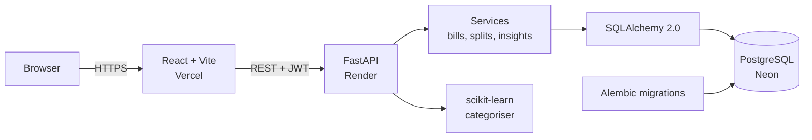

# Planora

**One login, one dashboard for everyday life:** recurring bills with reminders, trips with shared-expense splitting, everyday expenses and a grocery checklist, plus AI-powered expense categorisation and spending insights.

**Live demo:** https://planora-beta-flax.vercel.app
**API docs (Swagger):** `https://YOUR-API.onrender.com/docs`  <!-- replace with your Render URL -->
**Demo login:** `demo@planora.app` / `demo12345`  <!-- create this account on the live site and keep fake data in it -->

> Free hosting note: the backend sleeps when idle, so the first load can take about a minute while it wakes up.

<!-- Add 3-4 screenshots here: dashboard, bills, trip settlement, expenses with the AI suggestion -->

## Features

| Module | What it does |
|---|---|
| **Daily Bills** | Recurring bills (weekly / monthly / yearly) with reminders. Tick a bill as paid and the reminder stops, the payment is saved to history, and next cycle's bill is created automatically. Variable amounts, skip, undo. |
| **Trips** | Plan trips with friends (no account needed for them), itinerary, tickets, and shared expenses with equal or custom splits. Shows who owes whom and the fewest payments needed to settle up. |
| **Expenses** | Everyday spending with categories, filters, monthly totals and a category breakdown. |
| **Grocery** | Shopping checklist with bought / not-bought state, completed section and "clear completed". |
| **Dashboard** | Reminders, month spending, groceries left and upcoming trips in one view. |
| **Smart insights** | Forecasts the next amount of a variable bill, flags unusually high bills, and projects month-end spending. |
| **AI categorisation** | Suggests the category of an expense from its title while you type. |

## Architecture



**Stack:** React, Vite, FastAPI, SQLAlchemy 2.0, Alembic, PostgreSQL, JWT (PyJWT) with bcrypt, scikit-learn, pytest, Docker Compose (local database).

## Design decisions

- **Bill templates vs occurrences.** A recurring bill is a *template*; every month is a separate *occurrence* with its own due date, reminder date and payment. History is never overwritten, and a variable bill can have a different amount each month.
- **Status is computed, not stored.** UPCOMING / DUE / OVERDUE are derived from today's date; only PENDING / PAID / SKIPPED are stored. No scheduler to fail, and no stale statuses.
- **Month-end dates.** A bill due on the 31st falls on Feb 28/29 and Apr 30, then returns to the 31st (the original day is the anchor).
- **Money is exact.** Amounts are `Numeric(12,2)` and splits are computed in integer paise, so shares always add up to the total (e.g. Rs 100 split three ways is 33.34 + 33.33 + 33.33).
- **Settlement.** Balance = paid - share +/- recorded paybacks. A greedy matching of the biggest debtor with the biggest creditor settles everyone in at most (people - 1) payments.
- **Authorisation.** Every query is scoped to the logged-in user; someone else's record returns `404`, never `403`, so IDs cannot be probed.
- **Business logic lives in `services/`**, routers stay thin, which keeps the logic unit-testable.

## AI / ML

**Expense categorisation.** TF-IDF features (character n-grams to cope with typos and brand names, plus word n-grams) feeding a logistic regression, trained on 1,293 labelled examples across 8 categories. It also reuses the category you chose the last time you entered the same title.

Evaluated on titles the model never trained on (`python -m app.ml.train`):

| Test set | Result |
|---|---|
| 80 unseen titles using common words and brands | **100%** accuracy |
| 24 hard titles with brands and words it has never seen | **42%** accuracy |
| Hard set, only when confidence is at least 50% | answered 7 of 24, **6 of 7 correct** |

Because of that last row, the app only auto-fills a category when the model is at least 50% confident; otherwise it stays out of the way. The weakness is vocabulary, so the user-history lookup covers repeat entries.

**Smart insights.** Plain, explainable statistics: a linear trend over the last six payments for the next-bill forecast, a comparison with the earlier average for the "unusually high" alert (25% or more), and a pace-based month-end projection. They need at least three paid cycles, so they never guess from too little data.

## Tests

100 automated tests (`pytest`) cover authentication, the bill lifecycle (reminder stops on payment, next cycle created exactly once, undo), month-end dates, split arithmetic, settlement correctness, the ML accuracy thresholds, and authorisation (user A cannot read or change user B's data).

## Run locally (Windows / PowerShell)

```powershell
docker compose up -d                  # PostgreSQL
cd backend
python -m venv .venv
.venv\Scripts\Activate.ps1
python -m pip install -r requirements.txt
copy .env.example .env                # set JWT_SECRET to a long random value
python -m alembic upgrade head
python -m pytest -q
python -m uvicorn app.main:app --reload --port 8001
```

In a second terminal:

```powershell
cd frontend
npm install
npm run dev                           # http://localhost:5173
```

## Deployment

Neon (PostgreSQL) + Render (FastAPI, start command `alembic upgrade head && uvicorn app.main:app --host 0.0.0.0 --port $PORT`) + Vercel (React). Secrets live in environment variables, never in the repo.

## Known limitations and roadmap

- No email or push reminders yet; reminders appear on the dashboard.
- Trip access is owner-only; friends are names, not accounts.
- Percentage splits, itinerary and ticket screens in the UI, CSV export, and rate limiting on login are next.
- The categoriser is trained on a small hand-built dataset; more real, user-corrected data would improve it.
